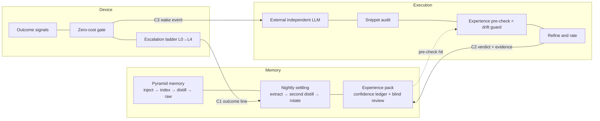

# Night-watch: An Architecture for Personal Agents with Unbounded Task Scope and a Single Entry

> This is not an installer and not a product manual. It is a **technical architecture document**: written for an AI, or for the person directing one. Follow it and you can build something similar; the implementation need not match one-to-one.
> Swap the host, the model, or the language — it still holds, as long as the invariants in `06-invariants.md` are kept.

- Version: `v0.1-draft` ｜ Author: `c-dyang` ｜ Docs license: CC BY 4.0 ｜ Appendix code: MIT
- Languages: [中文](../zh/00-front.md) ｜ [English](../en/00-front.md)
- Reading order: this file → Memory → Execution → Device → Appendices

---

## 0. Two hard requirements (where this architecture starts)

Night-watch was not drawn first and built later. It was **pushed out of two hard requirements** by a long series of real incidents:

| # | Requirement | What it means |
|---|---|---|
| **①** | **Unbounded task scope** | The task domain is **not closed in advance**. You cannot enumerate the classes of work it will be asked to do |
| **②** | **A single entry** | For the user there is **one conversation**, everything goes into it; not a set of feature-split endpoints |

In the original words: *"unbounded task scope, and the habitual single entry point from the user's side — those two hard requirements."*

Once both hold at the same time, they create three **standing pressures** (not three to-do items):

| Pressure | Comes from | Mechanisms that grew out of it | Domain |
|---|---|---|---|
| **Drift guard** | ① scope cannot be enumerated ⇒ execution paths explode | rules + gate + external independent verdict (**grown incrementally**) | Execution |
| **Forgetting guard** | ② one entry + finite context, yet the relationship must persist | pyramid memory / nightly settling / experience pack | Memory |
| **Silence guard** | ①+② stacked on an unattended machine | artefact signals / zero-cost gate / stepwise escalation | Device |

**The three domains are products of those pressures, not a module list designed up front.**

### 0.1 One key corollary: hard fences break a lot of things

*"In an unbounded task scenario, hard fences break a lot of things."*

This is the same choice made at every layer of this architecture: **use rules plus gates, not whitelist-style hard blocking.**

- A whitelist assumes you can enumerate what is allowed — requirement ① says you cannot;
- A hard fence also blocks **legitimate tasks nobody enumerated** (it breaks many things), while a rule can only **under-detect** (and can be extended);
- So every line of defence here is a **growable rule set**, never a frozen rulebook.

The only place hard blocking is allowed is the **safety boundary** (irreversible actions) — that is safety engineering, unrelated to whether to trust anything.

### 0.2 The means: move difficulty into structure, not into a more expensive model

One sentence for the **implementation strategy** (note: this is the means, not the starting point):

> **Use the judgement of free or local models to replace human inspection, so that devices and memory stay intact while nobody is watching.**

Behind it are four budgets — the first three save money, the fourth saves you from fooling yourself:

| Budget | The real question | Owner |
|---|---|---|
| **Attention** | Who is present, what do they look at, when is it cleared | Memory (sessions and context arrangement) |
| **Authority** | What may be done, was it done, is there a trace | Device (narrow action surface, escalation) |
| **Context** | How much is injected, what is retrieved, in what order | Memory (pyramid and retrieval discipline) |
| **Trust** | What to believe, how much, on what grounds the score moves | Experience pack, inside Memory |

The first two save money. The third saves you from being wrong. The fourth saves you from **fooling yourself**. The real cost of an unattended system is not spend — it is **unattended drift**.

---

## 1. Problem definition: three agent shapes, three different constraint sets

Put a desktop assistant, a cloud agent, and an unattended home server in one table and almost every dimension inverts. **Blending them is where most failures begin.**

| | Desktop assistant | Cloud agent | **Unattended home server** |
|---|---|---|---|
| Is anyone watching | Yes | Yes (or pay-per-call) | **No** |
| Whose login state | The human's | The human's / its own | **Its own** |
| Cost of failure | Noticed and fixed immediately | Retry the task | **Silent rot, discovered weeks later** |
| Cost model | Per interaction | Per call | **Long-term amortised, must be predictable** |
| Session lifetime | Longer is better | Single task | **Must be cleared periodically** |
| Who judges correctness | The human | Platform rules | **An external, independent judge** |
| Capability surface | Can be wide | Granted by platform | **Must be deliberately narrow** |

This document addresses only the last column. It does not discuss multi-tenancy, enterprise permission models, or "making the agent more human".

**Every cell in that last column is a consequence of the two requirements in §0** — this is not "the hardest of three shapes", it is a system with a completely different premise.

---

## 2. Eight design constraints (each traces back to those two requirements)

1. **Nobody is present** ⇒ no interactive first run, no dialogs, no waiting for confirmation. — from ①+②
2. **Sessions get expensive** ⇒ must be clearable and restartable (daily rotation), without losing memory. — from ②
3. **The model must be cheap** ⇒ move difficulty into structure instead of buying a better model. — from ② (the precondition for staying present)
4. **Authority must be narrow** ⇒ the agent should not have an arbitrary shell; the action surface is whitelisted. — from ① (see §0.1: rules, not hard fences)
5. **Failure must be visible** ⇒ every health verdict comes from **artefacts**, not from processes, not from dashboards. — from ①+② (nobody is watching)
6. **Memory must land on disk** ⇒ sessions are cache, files are truth. — from ②
7. **Cost must be predictable** ⇒ free/local models judge, cheap models generate. — from ② (must stay affordable forever)
8. **Single machine, single user** ⇒ no multi-tenancy, no permission model — only **boundaries**. — from ①+② (a personal context, not a platform)

Constraint 8 is often misread as "a simplification". It is the opposite: it spends the complexity on boundaries. With one machine and one user, the permission problem degrades from "who may access what" into "don't let the agent overreach on its own" — which is *harder*, because there is no counterparty to stop it.

---

## 3. Overview: how the three domains interlock

**One line of responsibility per domain:**

- **Memory**: let what should be known arrive within budget — structure (pyramid), timing (nightly settling), trust (experience pack).
- **Execution**: keep what is happening right now from drifting — an external independent LLM reads small snippets, pre-checks, and incidentally refines and rates experience.
- **Device**: let what has happened wake somebody — outcome signals pass a zero-cost gate first, then escalate step by step.

**One-line mnemonic**: **read path to Memory, write authority to review, three files.** Memory holds the experience pack's read path (it shares the retrieval entry with the pyramid) but not its write authority (the execution side owns the body, external blind review owns the score) [INV-M9].

**The three domains share no runtime**: no shared memory, no RPC, no message queue. They share **file formats**, and nothing else.

### 3.1 The three guards, as they actually stand (no polishing)

| Pressure | What is running | How far it is quantified |
|---|---|---|
| **Drift guard** | experience pre-injection (2,957 injections / 79 days) + external independent verdicts (673 ledger entries / 41 days) | Complete traceable artefacts, **value unquantified**; known boundaries = same-source auditor, audit sees text only (`07-sources.md` §4) |
| **Forgetting guard** | pyramid memory + nightly settling (69 days of daily logs) + experience ledger | Same: running, but no "how much worse without it" control |
| **Silence guard** | artefact signals + zero-cost gate + stepwise escalation | Gate zero-cost measured; value of graded criteria unquantified |

> Of the 32 invariants: **Q0 controlled 0 · Q1 traceable, not quantified 26 · Q2 observed, not quantified 6 · Q3 reasoned 0**.
> Why and what to do: `07-sources.md` §2 and §5. **It was built up from real operation; what is missing is quantification, not evidence.**

---

## 4. Only three contracts between domains

| Contract | Producer → consumer | Carrier | Key constraint |
|---|---|---|---|
| **C1 Outcome line** | Device → (nightly settling) → Memory | Append-only audit line | The writer must be the **supervisor**, never the supervised task [INV-X1] |
| **C2 Verdict and evidence** | Execution → (rating) → Memory·experience pack | Structured verdict record with anchor and reason | Evidence must point at a production session snippet [INV-E4] |
| **C3 Wake event** | Device gate → Execution | One event carrying the raw signal and the gate's reasoning | No wake without passing the gate [INV-D4] |

**Interface discipline**: between domains there are no "calls", only files landing as agreed. The payoff is not aesthetic decoupling but **replaceability**: any domain can be rewritten wholesale without touching a line of the other two, as long as the file format holds [INV-X2].

---

## 5. Cross-domain failure modes (the ones no single domain can fix)

A single-domain failure can be patched with another rule. A cross-domain failure can only be fixed by changing structure. These are the reason this architecture exists:

| Failure | Why one domain cannot fix it | Structural answer |
|---|---|---|
| **The supervised writes its own audit** | The more "normal" the task looks, the less you can see it is broken | Separate write authority [INV-X1] |
| **Observation point mid-chain** | The green dashboard is true, and so is the broken chain | Health verdict from the end-of-chain artefact [INV-D2] |
| **Executor outcome unobservable** | The scheduler sees a constant success, with a layer in between | The executor reports its own outcome [INV-D3] |
| **Suppression as blinding** | Too fine (noise remains) or too coarse (all blinded together) | Granularity ≥ independently failing unit, plus TTL [INV-D7] |
| **Clearing a session loses memory** | That is the inherent price of rotation — unless settling happens first | Settle before clear [INV-M4] |
| **Judgement collapsing into self-justification** | A model in the same context cannot argue against itself | External judge + raw snippet input [INV-E1/E2] |
| **Experience only accumulates** | The more authoritative the store, the less refutable it becomes | Refutability + tombstones + write/rate separation [INV-M7/M9] |

---

## 6. Roadmap (honest version: where it stands)

1. **Single machine, single session (current shape)**: three domains present, the ladder present, the self-heal surface deliberately narrow (idempotent actions only).
2. **Close the loop**: verdicts flow back (a false positive writes back into the rule set or the suppression table) and unhandled escalations nag again. Current gap: **AI in the loop rather than a closed loop** — once a verdict reaches a human, the system will not chase it.
3. **Multi-node**: extend the device domain beyond one node, tag the rule set per node. Not done.
4. **Swap the host**: extract the host adapter into an interface and validate portability against a second host. This is the most important credibility test of the whole document.

> One **major host-version migration** has already happened (dependency-resolution layer rebuilt, configuration carrier replaced, credential model changed); this version only claims "replaceable by design" — the before/after comparison is left for the next revision.

---

## 7. After reading this, you should be able to answer

- Why do the two requirements (unbounded task scope + a single entry) force out three domains rather than one module?
- Why must sessions in this kind of system rotate daily, while a desktop assistant's session should live forever?
- Why can't "the health check passed" be trusted from the checker's own return value?
- Why should judgement go to a cheap model in a separate process instead of the main model's introspection?
- Why can't the experience pack be append-only, and why can't it score itself?
- Why must every outcome signal pass a free gate first?

Where the answers live:

| Question | Read |
|---|---|
| Why the two requirements force three domains | This file §0, §2 |
| Why sessions must rotate daily | This file §1, §6 ｜ Memory §2 (settle before clear) |
| Why the checker's own return value cannot be trusted | Device §1 (three reading rules), §2 (the gate) |
| Why judgement goes to a cheap model in a separate process | Execution §1 (why self-review fails) |
| Why the experience pack cannot be append-only or self-scored | Memory §3 (read path / write authority in three parts) |
| Why every signal passes a free gate first | Device §2 (the zero-cost gate) |

Every conclusion above resolves to an ID in `06-invariants.md`. Where it does not, the sentence is either deleted or demoted to "process discipline" in the appendix.

---

> Sessions can be wiped every day, because memory is not in the session;
> models can be cheap, because the hard parts were moved into structure;
> and "should I believe this" is managed by a module of its own.
