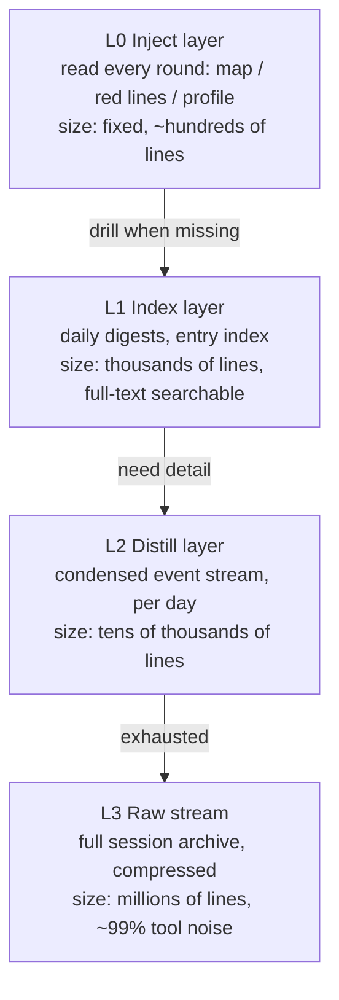
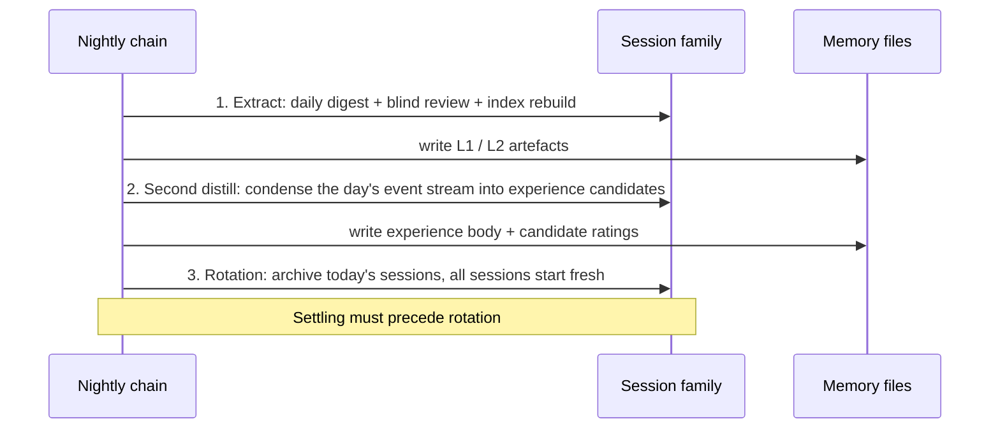

# Memory: Pyramid, Nightly Settling, and the External Experience Pack

> The memory domain does three things only: **give structure** (the pyramid), **give timing** (nightly settling), **give trust** (the external experience pack).
> It is not responsible for being clever. It is responsible for letting what should be known arrive within budget — and for giving suspicion somewhere to live.

---

## 1. Pyramid memory: inject the map, not the content

### 1.1 Four layers



| Layer | Content | Written by | When | Read by |
|---|---|---|---|---|
| L0 Inject | Map (what each file is for, how to search), red lines (cross-session prohibitions), profile | Human / main session | Session start, injected each round | Every session |
| L1 Index | Daily digests, experience entry index | Nightly chain (automatic) | Every night | Retrieval entry point |
| L2 Distill | Per-day condensed event stream | Nightly chain (automatic) | Every night | When raw detail is needed |
| L3 Raw | Full session stream, compressed | Host (automatic) | Contiguously | Last resort |

**Why a pyramid and not "one big knowledge base"**: retrieval cost and noise both grow with volume. Each layer is a **noise-reduced view** of the one below (L0 is a manual, L1 a digest, L2 a condensation, L3 the raw record). You search upward from the small end and stop when you find it — that is cost discipline *and* judgement-quality discipline: concluding from one failed snippet in L3 is worse than not looking at all.

This is the first invariant of the domain: **inject the map, not the content** [INV-M1] — the reader receives instructions for *where to look*, not a bellyful of conclusions.

### 1.2 Drill-down discipline

```
1. Read the L0 map → learn which layer to go to
2. Search the index → locate "which day / which entry"
3. Read that day's L2 distill (condensed event stream)
4. Only if exhausted, decompress L3
```

Two prohibitions:

- **No layer skipping**: never open L3 first. ~99% of the raw stream is tool calls and outputs; skipping means judging on the dirtiest data available [INV-M2].
- **No full reads**: no single source of truth (other than fixed-size L0-style files) is read end to end; locate a section, read the section [INV-M11]. Once a file grows, "read it all" is slow-motion suicide of the context budget.

### 1.3 Source of truth vs derived artefacts

| Role | Example | Rule |
|---|---|---|
| Source of truth | Experience body, daily distill, red-line file | Written by humans or appended by the nightly chain; **never written back by an index** |
| Derived artefact | Full-text index, entry index, digests | **Rebuilt wholesale only**; no hand edits, no incremental patching [INV-M3] [INV-M5] |

A derived artefact must survive "delete it and rebuild" with no information loss; that is the only test that separates it from a source of truth. Any index that cannot be rebuilt has in practice become a second source of truth — and two sources of truth always drift apart.

### 1.4 Failure modes at this layer

| Failure | Symptom | Test |
|---|---|---|
| Index drifts from body | Search hits contradict the body | Sample 10 hits, verify each against the body |
| Archive never indexed | The file exists but search never finds it | File count vs index entry count mismatch |
| Inject layer bloats | Fixed opening cost eats the budget | Track L0 size; monotonic growth is bloat |
| Full-read regression | One file consumes the whole context | Record the largest single-file read |

---

## 2. Nightly settling: timing and ordering are not interchangeable

### 2.1 Sequence



There is **no retry** between the three stages, only "report the missing layer".

### 2.2 Three hard orderings

| Ordering | Why it cannot be swapped | Consequence of violation | Invariant |
|---|---|---|---|
| **Settle before clearing** | Clearing really deletes anything not yet persisted | The day's detail is gone forever, with no error | [INV-M4] |
| **Rebuild indexes wholesale, never incrementally** | Incremental updates strand entries after edits and deletions | The index drifts slowly and gets less accurate | [INV-M5] |
| **Do not re-run on failure; report the gap** | A re-run turns "a gap" into "looks filled in" | One link is broken while every report is green | [INV-M6] |

Ordering 3 is the counter-intuitive one: **automatic retry is harmful here.** The nightly chain's first value is its output; its second value is **reporting gaps**. A successful retry hides the fact of "why it broke this time" — and in an unattended system, facts are more expensive than output.

### 2.3 Write authority of supervisor and supervised must be separated

This is the most important rule in this chapter, and one of the root invariants of the whole architecture:

> **A liveness line or audit line must never be written by the task being supervised.** [INV-X1]

The reason is logical, not a matter of trust: a task writing "I finished" only proves it reached the line where it writes that; if it is killed afterwards, the line still exists, perfectly formatted. Worse — if it is also the thing that writes "I did not run", then when it fails, **the only mechanism capable of reporting its failure dies with it**.

Correct structure:

| Role | May write | Must not write |
|---|---|---|
| The supervised task | Its own business artefacts | Any conclusion about its own success |
| The supervisor (external scheduler / checker) | Conclusion lines about the task | Business artefacts |

**Practical corollary**: the liveness line belongs to an independent process that checks *whether the artefact appeared*, not to the task that produces the artefact. The former still runs when the latter fails.

### 2.4 Failure modes in this stage

| Failure | Symptom | Test |
|---|---|---|
| Observation point mid-chain | Second half dies, panel stays green | Freshness judged on the **end-of-chain** artefact timestamp |
| Launcher swallows exit codes | The scheduler always sees success | The executor must self-report its exit code [INV-D3] |
| Settle and clear in one batch | Occasionally lose a whole day | Check ordering: artefact mtime < session archive time |
| Silent failure | Only "no output", never "failed" | Distinguish "empty result" from "did not run" |

---

## 3. The external experience pack: a third sub-block of Memory, with different write authority

### 3.1 Position: read path, physical carriers, and write authority are three different things

**Memory answers "where is it"; the experience pack answers "how much should I trust it".** Saying they "both live in the memory domain" is true along **one axis only**, so separate the axes before arguing about ownership:

| Axis | The question it asks | The experience pack's answer |
|---|---|---|
| **Read path** (who consumes it) | Who fetches it, and does it arrive through the same retrieval entry | **Belongs to Memory**: shares the retrieval entry and the injection budget with the pyramid |
| **Physical carriers** (how many files) | Is it one file | **Three separate files**: entry body / confidence ledger / blind-review question bank |
| **Write authority** (who may change it) | Who may append, who may change a score | **Does not belong to Memory**: the execution side only appends, external blind review only re-scores, the nightly chain only rebuilds derived indexes |

Which reduces to one paragraph:

> On the **read** side the experience pack belongs to Memory — a reader should not need to know whether this item is "memory" or "experience"; it arrives through the same retrieval path.
> On the **write** side it does not belong to Memory — the body is appended by the execution side, scores are changed by external blind review, and the nightly chain holds exactly one power over it: rebuilding derived indexes wholesale.
> In other words: **Memory holds its read path, not its write authority; physically they were never the same file.**

Why not say "it belongs to Memory, except for write authority": **ownership is an organisational question; write/rate separation is an invariant.** Organisation may be merged (this implementation did merge it); the invariant may not be conceded [INV-M9]. The other phrasing invites readers to hear "one thing in principle, with an exception", which is the exact opposite of the truth.

Counter-example test (goes into the self-check list): **if any single step can both write the body and change the score, the implementation already violates `INV-M9`.**

The comparison table below is about "does it read like one thing" versus "does it write in one place":

| | Memory (pyramid) | Experience pack |
|---|---|---|
| Input | Sessions and artefacts | Production session snippets + external verdicts |
| Output | Searchable layered views | Scored entries with citable evidence |
| Written by | Nightly chain | Execution side (entries and evidence only) |
| Score changed by | — | **External blind review (score changes only)** |
| Fear when it fails | Cannot find it | **Believes the wrong thing** |

Merging them into one file has a predictable outcome: the author and the rater become the same party, and scores become a mirror of self-description [INV-M9].

### 3.2 Entry structure

```json
{
  "id": "EXP-0001",
  "title": "One-line conclusion (imperative preferred)",
  "type": "fact | pitfall | procedure | preference",
  "confidence": 0.0,
  "evidence": [
    {"kind": "session_snippet", "anchor": "<session / turn locator>", "strength": "measured | observed | claimed"}
  ],
  "tombstoned": false,
  "deprecated_by": null,
  "updated_at": "<ISO timestamp>"
}
```

Key points:

- `evidence` must point at **production session snippets**; "the model thinks it is right" and "the document says so" do not qualify [INV-E4].
- `strength` uses the same three tiers as the invariant table (measured / observed / claimed). **Evidence strength and score are separate**: a `claimed` entry may score high, but the reader must know it is reasoning.
- `tombstoned` instead of physical deletion: a refuted experience is still information ("we tried this path; it does not work").

### 3.3 Verdict protocol

| Action | Who | Constraint |
|---|---|---|
| Write entry | Execution side | Must carry an evidence anchor; no anchor, no entry |
| Score / re-score | External blind review | Range ±1/±2/±3; **negative scores require a reason**; the input list carries **no existing scores and no author self-assessment** [INV-M8] |
| Outright reject | Human | Veto, overrides any score |
| Retire | Nightly chain | Sustained low score → tombstone; the body is not deleted |
| Exemption | Config | Foundational entries reject negative scores only, never positive ones (so the foundations cannot be voted away) |

**Blind reviewer design** (three hard requirements):

1. **Self-contained role text**: the prompt does not depend on conversation context; you can copy it elsewhere and run it.
2. **Precise input**: only the entries to judge plus their raw snippets — **never** the previous score.
3. **Enforced structured output**: score + reason + anchor; a verdict missing any of the three is void.

### 3.4 Two clock speeds

| Speed | Signal | When it takes effect | Example |
|---|---|---|---|
| Fast | Overreach, omission, clear violation | Corrected **within 1 round** | Touching a sensitive resource without confirmation → block and record |
| Slow | Entry confidence, rule thresholds | Weekly / monthly (nightly chain) | An experience refuted three times → score down to tombstone |

Mixing the two tempos is a common error: slow tempo on overreach means the incident already happened; fast tempo on confidence means the ledger oscillates every second until nobody reads the scores any more [INV-M10].

### 3.5 Failure modes in this section

| Failure | Symptom | Countermeasure |
|---|---|---|
| Self-assessment inflation | Scores drift upward, no discrimination | Separate write and rate; blind review without prior scores |
| Append-only | Wrong experience reads more authoritative as it ages | Tombstones + refutability |
| Sampling bias | Only the sampled snippets get judged | Make the sampling rule explicit and record the unjudged share |
| Halo effect | High scorers stay high | Strip marks from the list (no scores, no authors) |

---

## 4. Minimal contract (what must survive any reimplementation)

### 4.1 File inventory (by role, not by path)

| Role | Shape | Required fields / structure |
|---|---|---|
| Inject layer | Single file, fixed size | What each file is for + how to search (**instructions, not content**) |
| Index layer | Full-text index + daily digests | Date, title, source, one-line digest |
| Distill layer | One per day | Events, conclusions, gaps (which step is missing) |
| Raw stream | Compressed archive | Decompressible, locatable by date |
| Experience body | Single file, append-only | Entry ID, title, type, evidence anchor |
| Confidence ledger | Structured records | Entry ID, score, reason, timestamp, judge |
| Question bank / blind index | Derived, rebuildable | Entry ID, question to judge, **no score** |

### 4.2 Three measurable checks (is this memory still alive?)

1. **Traceable**: pick any of today's conclusions; its evidence anchor is findable within three retrievals.
2. **Rebuildable**: delete every derived artefact; the nightly chain rebuilds them with no loss of retrieval quality.
3. **Refutable**: pick any experience and demonstrate the full path of "it gets falsified → score drops → tombstoned".

If any of the three fails, the memory domain has degraded into "a pile of files".

---

## 5. Failure modes summary for this chapter (honest list)

- Settling fails unnoticed ⇒ that day's detail is gone forever (ordering plus silence).
- Index drift ⇒ search hits contradict the body, with no way to tell which is stale.
- Inject-layer bloat ⇒ fixed per-round cost rises; long-term amortisation breaks.
- Self-assessment inflation ⇒ the ledger loses discrimination, i.e. no ledger at all.
- Append-only ⇒ wrong experience calcifies and binds every new session.
- Full-read regression ⇒ one file eats the context; judgement quality drops.

---

## 6. Building the smallest working version (order matters)

1. Write a one-page **inject layer**: file map (what each file is for, how to search) plus no more than ten red lines.
2. Build the **index layer**: start with full-text search (for CJK you must handle segmentation or bigram indexing — do not trust default tokenisation).
3. Build the **raw-stream archive** and wire one rotation action (initially only "can clear without losing files").
4. Write **nightly step one**: extract → digest → index rebuild, **and** write one audit line saying whether that step succeeded (written by the supervisor).
5. Add **second distillation**: condense the day's event stream into experience candidates (no scoring yet).
6. Only then add **external blind review**: at the single junction "candidate → ledger", scoring only, no pre-checks yet.

By step 4 you already have a working unattended memory; step 6 is where trust begins. **Reverse the order and you get a pile of conclusions nobody believes.**
