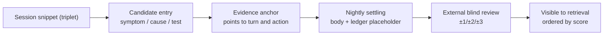

# Execution: External Independent LLM, Snippet Audit, and the Drift Guard

> Memory handles "what should be known arrives". This chapter handles "what is happening right now does not drift".
> One line: **self-discipline during execution cannot be trusted, so move judgement outside the session, look at small snippets, and refine and rate experience along the way.**

> ⚠️ The six invariants in this chapter: **four are running and traceable (`Q1`)** — external verdicts, raw-snippet input, post-hoc correction, evidence from production sessions only; **two are `Q2` (events exist, no systematic record)** — two-tier latency, pre-checks that never become approvals.
> **Not one is `Q0` (controlled/quantified); not one is `Q3` (pure design reasoning).**
> Read them as *built up from real operation, with value not yet quantified* — not as *design reasoning*, and not as *proven*. See `07-sources.md` §2 / §4.

---

## 1. Why judgement must live outside the session

### 1.1 Why self-review fails

Three reasons, strongest first:

| Reason | Explanation | Consequence |
|---|---|---|
| **Context is a position** | Inside one context, a model feels commitment-consistency pressure toward choices it just made, and finds reasons for them | Overreach is retold as "reasonable adaptation"; omission as "not needed" |
| **Curation is concealment** | If the executing side decides "what the auditor sees", it can hand over a presentable digest | Audit pass rate approaches 100%, and the passes carry **zero information** |
| **A premium model cannot self-check frequently** | Judgement must run every round and be reproducible; self-checking with the main model makes the most expensive compute a routine cost | Judging frequency is squeezed down to "look once after an incident" [INV-X4] |

The first two combine into the root of this chapter: **judgement must come from outside the session, and the input must be the raw snippet** — two independent invariants [INV-E1] [INV-E2].

### 1.2 Three isolations

| Isolation | What it means | What breaks without it |
|---|---|---|
| **Process** | Judgement runs in a separate process/call, not sharing the main session's context | Judgement is contaminated by the main session's existing reasoning |
| **Prompt** | The judging prompt is self-contained (role, criteria, output format all inside), copyable and runnable elsewhere | Prompt depends on conversation history ⇒ irreproducible, unregressable |
| **Ledger** | Verdicts go to an independent ledger that only the external side may modify | The execution side can edit scores ⇒ write and rate merge, ledger void [INV-M9] |

### 1.3 The authority boundary of a verdict

> **An external verdict says "this step has a problem"; it never says "here is how you should change it".**

This is not caution, it is protection against **dual command**. The moment the judge starts issuing instructions, the executor has two superiors, and its default behaviour under conflict is to obey **the cheaper one** — and the cheaper one is usually "don't change anything". A verdict stops at **class + anchor + reason + severity**; the remedy belongs to the executor or to a human.

### 1.4 Cost structure

Judging must satisfy two properties, or it will naturally decay into "spot checks after the fact":

1. **Cheap per call**: free/local models; one call = one snippet + one fixed rubric, short output.
2. **Constant calls per round**: the number of verdicts depends on the **number of snippets**, not on session length. That is the economic reason for the small-snippet design — not an accuracy reason.

---

## 2. Snippet audit

### 2.1 What a snippet is

A snippet is not "the last N turns of conversation"; it is a **triplet**:

```
intent (what the user or task asked for) → action (what was actually done: tool calls, file writes, messages) → outcome (tool return, artefact, exit code)
```

Conversation alone makes the judge reward phrasing; actions alone lose intent and cannot detect overreach. If any leg is missing, the correct verdict is "undecidable", never "ok".

### 2.2 Why small snippets

| Dimension | Small snippet | Whole session |
|---|---|---|
| Locating precision | Points at **a specific turn and a specific action** | Can only say "the whole thing feels risky" |
| Cost | Linear, budgetable, batchable | Superlinear in length |
| Reproducibility | Re-running the same snippet should give the same band | Different context each time, random verdicts |
| Contamination | Unaffected by later reasoning | Later turns rationalise earlier ones |

### 2.3 Three criteria classes

| Class | Question | Typical evidence | Severity |
|---|---|---|---|
| **overreach** | Did something it was not authorised to do | Action outside the whitelist / sensitive surface without confirmation | High, may block immediately |
| **omission** | Promised but did not do, or skipped required verification | Claimed "already changed" with no artefact / no exit code | Medium-high, recorded and corrected |
| **disorder** | Skipped a mandatory step | Cleared before settling / edited config before backup | Medium, recorded |

Severity decides the latency class (2.5). The criteria themselves must be **enumerable**: these three are, so they are safe as upfront criteria; "is this answer good" is not enumerable, and therefore must not be an upfront criterion [INV-E3].

### 2.4 Verdict record (structured output)

```json
{
  "snippet_id": "<session / turn locator>",
  "class": "ok | overreach | omission | disorder | undecidable",
  "severity": "low | medium | high",
  "anchor": "<where in the snippet: which turn, which action, which field>",
  "reason": "<one sentence another person could re-check>",
  "score": 0,
  "judge": "<model / rule identifier>",
  "created_at": "<ISO timestamp>"
}
```

Three hard rules:

- `class=ok` needs no reason; **any other class without `reason` is an invalid verdict** (record "invalid", not "passed").
- `anchor` must lead back to the raw snippet; if it cannot, it was invented.
- `score` may only be filled by the external side (placeholder here); the execution side submits it empty.

### 2.5 Two latency classes

| Class | Trigger | Latency | Authority |
|---|---|---|---|
| **Immediate correction** | Only `overreach` with `severity=high` | **≤1 round**, synchronous | May block (refuse to execute / demand confirmation) |
| **Asynchronous ledger** | Everything else | Minutes to hours | May record, cannot block |

Design intent: **the synchronous channel should be as narrow as possible.** Synchronous judging slows the main path, and once the main path is slow, the cheapest optimisation available is to turn the audit off [INV-E5]. Only the class that causes irreversible damage is allowed to block.

---

## 3. Experience pre-check = the drift guard

### 3.1 Three shapes of drift

| Shape | Symptom | Test |
|---|---|---|
| **Goal drift** | Gradually departs from the original request, unaware | Actions no longer correspond to the original request's object or keywords |
| **Calibration drift** | The same number, path, or conclusion stated differently each time | One entity appears repeatedly with inconsistent values |
| **Authority drift** | The action surface quietly expands (read-only first, config edits later) | Action class level rises monotonically |

What all three share: **each round is reasonable; only the sequence is wrong.** That is why an external viewer reading the snippet sequence catches it, while an internal viewer reading the current round does not.

### 3.2 When pre-checks run, and the cost gate

Pre-checks do not run every round; they run only when **the action class** matches:

| Action class | Example | Pre-check |
|---|---|---|
| Read-only | Read a file, search, query | Does not run (zero cost) |
| Reversible write | Write an artefact, generate a report | Light: hint if an experience entry matches |
| Irreversible / sensitive | Delete or edit config, send a message, touch credentials, restart a service | Mandatory: matching entries + risk + counter-example |

**The classification itself costs nothing** (a table lookup by action class), so "pre-checks exist" does not mean "pre-checks burn money".

### 3.3 What a pre-check emits

A pre-check emits **hints**, not **permits**:

```
Matched entry: EXP-00xx (related experience / pitfall)
Risk: <one sentence>
Counter-example: <what happened last time a similar action was taken>
Suggestion: <optional; the executor may ignore it>
```

Three disciplines:

- **Never blocks**: only `overreach` blocks; a pre-check merely hints [INV-E6].
- **A counter-example beats a rule**: counter-examples can be judged for applicability; rules can only be obeyed or ignored.
- **Report a miss as a miss**: never invent "be careful" just to look useful.

### 3.4 Post-hoc correction outranks pre-routing

This is the most contentious rule in the chapter, and worth stating plainly:

> **No upfront classification in open domains; correct after the action.**

| Approach | Problem |
|---|---|
| Pre-routing (decide "what class of task is this", then dispatch) | Classes are unenumerable ⇒ rule explosion; new situations get blocked first ⇒ **suppresses exploration**; rules expire and turn toxic (blocking exactly what should now be done) |
| **Post-hoc correction** (act first, judge the snippet, correct if wrong) | Price: occasionally wrong once; payoff: **new situations are not blocked**, and rules grow out of real failures |

**Enumerably-closed domains are the exception**: "file suffix → handling tool" is closed, cheap to be wrong, and pre-routing is correct there. The test is not "before or after"; it is **are the classes enumerable, and is failure reversible**.

### 3.5 Three hard anti-drift actions

1. **Re-read the original request before acting**: take the original text (not a memory of it) and align once.
2. **Read values and paths from tools, never from memory**: any IP, port, line count, timestamp is fetched live; "I remember it was…" is banned (this cuts both calibration drift and hallucination).
3. **Block on overreach only**: a block must rest on "outside the whitelist / unconfirmed sensitive surface", never on "I don't think this is necessary".

---

## 4. Incidental output: refining and rating experience

The execution domain is the only place that produces **real evidence**, so refining and rating experience happens here rather than letting Memory "write experience from impressions".

### 4.1 Pipeline (five steps, fixed order)



### 4.2 Rating evidence comes only from production sessions

> **The only legitimate evidence for an experience's score is a snippet from a production session.** [INV-E4]

Three things that do not count as evidence:

- The model's self-report ("I believe this is safer") — no anchor, not re-checkable.
- A document retelling ("the official docs say…") — external information, not a fact about this system's operation.
- Someone else's experience ("generally speaking…") — may enter as a `claimed` entry, but must not earn a high score on that basis.

Corollary: **writing well must not earn score.** If the ledger rewards expressiveness, you end up with a beautiful and useless experience library.

### 4.3 Division of labour

| Role | Only does | Never does |
|---|---|---|
| Execution side (the working session) | Submit snippets, write candidate entries, attach evidence anchors | Score its own entries, edit the ledger |
| External blind review (cheap model in a separate process) | Read raw snippets and entries, produce score and reason | Edit the body, edit criteria, issue instructions to the executor |
| Human | Veto, reprioritise, decide on release | — |
| Nightly chain | Rebuild derived indexes wholesale, tombstone by rule | Change scores, change body conclusions |

### 4.4 How scores get used (as opposed to how they get assigned)

Scores have exactly three legitimate uses; everything else should not consult them:

1. **Ordering**: for a topic, higher-confidence entries arrive first.
2. **Hint strength**: high-score entries may enter the inject-layer digest; low-score ones stay in the retrieval layer.
3. **Retirement**: sustained low score → tombstone.

**What not to do**: use scores to decide *whether an action is permitted* (a score is trust, not a permit); compare scores across topics (scores on different topics are not commensurable).

---

## 5. Minimal contract

### 5.1 Three structured artefacts

| Artefact | Written by | Structural essentials |
|---|---|---|
| Snippet package | Execution side (per round / per action) | `intent / actions[] / outcomes[]`, all raw (never summarised) |
| Verdict record | External side | The JSON in 2.4; `reason` required whenever `class != ok` |
| Candidate entry | Execution side | `title / type / evidence[anchor, strength]`, **no `confidence` field** (scores are filled by the external side) |

That missing field is the design: **the submission format has no slot for a score, so the execution side physically cannot self-assess.** Enforcing an invariant through the format beats writing ten reminders about discipline.

### 5.2 Three measurable checks

1. **Reproducible**: re-running a verdict on the same snippet should land in the same `class` and `severity` band (wording of `reason` may vary). Above 20% disagreement ⇒ criteria are vague; go fix the prompt.
2. **Anchorable**: sample 20 verdicts; every `anchor` leads back to the raw snippet. Any that does not was invented.
3. **Non-blocking**: measure the share and duration of the synchronous channel; if the average synchronous verdict takes longer than an ordinary tool call, it belongs on the async path [INV-E5].

---

## 6. Failure modes in this chapter (honest list)

| Failure | Symptom | Structural cause |
|---|---|---|
| Audit degenerates into rubber-stamping | Pass rate ≈100%, never blocked anything | Input was curated / judgement in the same context [INV-E1/E2] |
| Pre-check becomes approval | Every action waits for confirmation; unattended in name only | The pre-check was given blocking authority [INV-E6] |
| Rules turn toxic | Something that should be done is blocked by an old rule | Pre-routing plus rules without a TTL |
| Ledger rewards expressiveness | Top scores always belong to the best-written entries | Rating evidence is not a production snippet [INV-E4] |
| Judging gets too expensive and is switched off | Audit exists for two weeks, then quietly stops | Judging did not use "free model + constant count" |
| Dual command | The executor obeys whichever superior is cheaper | The judge crossed into issuing instructions |

---

## 7. Building the smallest version (order matters)

1. **Do one thing first**: record every action as a triplet snippet (intent / action / outcome) on disk. **No judging yet.**
2. Wire **one independent-process** judging call, `overreach` only, three-valued output: `ok / overreach / undecidable`.
3. Add the **async ledger**: every verdict is recorded first and blocks nothing.
4. Keep exactly one synchronous channel for `overreach` with `severity=high`.
5. Add **pre-checks**, only for irreversible/sensitive actions, emitting hints and never permits.
6. Only then add **candidate entries and blind re-scoring**, and bake "no `confidence` field" into the submission format.

After step 1 you can already answer "what did it actually do this time"; step 4 is the first point where accidents are prevented; step 6 is the experience loop. **Anyone who starts at step 6 ends up with a pile of scores nobody believes.**
