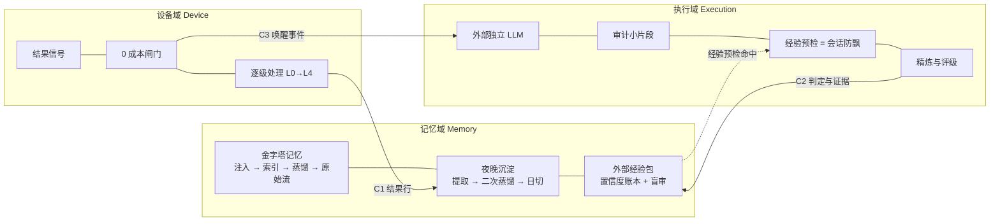

# Night-watch：无限任务范围 · 单会话入口下的个人 agent 长期架构

> 这不是安装包，也不是产品说明书。它是一份**技术架构书**：给 AI，或者给"指挥 AI 的人"读。照着能搭出一个差不多的东西，实现不必一一对应。
> 换宿主、换模型、换语言都成立 —— 只要守住 `06-invariants.md` 里的那些不变量。

- 版本：`v0.1-draft` ｜ 署名：`c-dyang` ｜ 文档许可：CC BY 4.0 ｜ 附录代码：MIT
- 语言：[中文](../zh/00-front.md) ｜ [English](../en/00-front.md)
- 阅读顺序：本文件 → 记忆卷 → 执行卷 → 设备卷 → 附录

---

## 0. 两条硬性要求（这套架构的起点）

Night-watch 不是先画图纸再实现，是**从两条硬性要求出发、被真实事故一路推出来的**。这两条要求是：

| # | 要求 | 含义 |
|---|---|---|
| **①** | **无限任务范围** | 任务领域**不预先封闭**。不能事先枚举"它要干哪些类活" |
| **②** | **单会话入口** | 对用户而言**只有一个对话框**，所有东西都往里塞；不是一堆按功能切开的入口 |

原话就是这么两句：*"针对无限任务范围和习惯性的对用户而言的单会话入口，其实就是这两个硬性要求。"*

这两条一旦同时成立，就形成三个**持续压力**（不是三个待办事项）：

| 压力 | 从哪条要求来 | 长出来的机制 | 落在哪个域 |
|---|---|---|---|
| **防偏** | ① 范围不可预设 ⇒ 执行路径穷举不了，一定会跑偏 | 判据 + 闸门 + 外部独立判定（**可增量生长**）| 执行域 |
| **防忘** | ② 单入口 + 上下文有限，但关系必须连续 | 金字塔记忆 / 夜晚沉淀 / 经验包 | 记忆域 |
| **防崩** | ①+② 叠加在无人值守的机器上 | 产物信号 / 0 成本闸门 / 逐级处置 | 设备域 |

**三域是这三个压力的产物，不是预先设计的模块集合。**

### 0.1 一条关键推论：强围栏会坏掉很多东西

*"一个无限的任务场景，强硬的围栏会坏掉很多东西。"*

这是本架构在**每一层**上都不约而同做出的同一个选择：**用「判据 + 闸门」，不用「白名单式硬拦」**。

- 白名单假设你能枚举"允许什么" —— 而要求 ① 说的就是不能枚举；
- 硬拦会同时拦掉**没被枚举到的合法任务**（坏掉很多东西），而判据只会**漏判**（可增量补）；
- 所以本架构所有防线都是**可生长的判据表**，不是一次性写死的规则集。

唯一允许"硬拦"的地方是**安全边界**（不可逆操作）—— 那是安全工程，与"信不信"无关。

### 0.2 手段：把"难"搬进结构，而不是买更贵的模型

一句话概括**实现策略**（注意：这是手段，不是起点）：

> **用免费或本地模型的判定力，替代人的巡检力，让设备与记忆在没人看着的时候保持完整。**

它背后是四笔预算 —— 前三笔是"省钱"，第四笔是"省骗自己"：

| 预算 | 真正的问题 | 归谁管 |
|---|---|---|
| **注意力** | 谁在场、看什么、什么时候清空 | 记忆域（会话与上下文安排） |
| **权限** | 能做什么、做没做、留没留痕 | 设备域（执行面收窄与提级） |
| **上下文** | 注入多少、检索什么、以什么顺序 | 记忆域（金字塔与检索纪律） |
| **可信度** | 信什么、多信、凭什么改分 | 记忆域内的经验包 |

**无人值守系统真正的成本不是钱，是无人纠正的偏差。**

---

## 1. 问题定义：三种 agent 形态，约束完全不同

把桌面助手、云 agent、无人值守家用服务器放在一张表里，会发现它们几乎每个维度都相反。**混着设计是绝大多数失败的开端。**

| | 桌面助手 | 云 agent | **无人值守家用服务器** |
|---|---|---|---|
| 有人看着吗 | 有 | 有（或按次付费） | **没有** |
| 登录态归谁 | 人的 | 人的 / 自己的 | **自己的** |
| 失败代价 | 当场发现、当场改 | 任务重试、丢一次调用 | **静默腐烂，几周后才发现** |
| 成本模型 | 按交互 | 按调用 | **长期摊销，必须可预测** |
| 会话寿命 | 越长越好 | 单任务 | **必须定期清空** |
| 谁判断对错 | 人 | 平台规则 | **外部独立判定** |
| 能力边界 | 可以宽 | 平台给的 | **必须故意窄** |

本白皮书只解决最后一列。它不讨论多租户、不讨论企业权限模型、不讨论"让 agent 更像人"。

**这张表的最后一列，全部是 §0 那两条要求的必然后果** —— 不是三种形态里"更难的一种"，而是一个前提完全不同的系统。

---

## 2. 八条设计约束（每条都能追到那两条要求）

| # | 约束 | 来自 |
|---|---|---|
| 1 | **没有人在场** ⇒ 不能有交互式首次运行、不能弹窗、不能等人确认 | ①+② |
| 2 | **会话会变贵** ⇒ 必须能清空重来（日切），且清空不丢记忆 | ② |
| 3 | **模型必须便宜** ⇒ 把"难"搬进结构，而不是买更贵的模型 | ②（长期在场的前提） |
| 4 | **权限必须收窄** ⇒ agent 不该有任意 shell；执行面按**判据**收窄，不做硬围栏 | ①（见 §0.1） |
| 5 | **失败必须可见** ⇒ 一切健康结论取自**产物**，不取自进程、不取自面板 | ①+②（没人看着） |
| 6 | **记忆必须落盘** ⇒ 会话是缓存，文件是真相 | ② |
| 7 | **成本必须可预测** ⇒ 判定用免费/本地模型，生成用便宜模型 | ②（能长期开下去） |
| 8 | **单机单用户** ⇒ 不做多租户、不做权限模型，只做**边界** | ①+②（个人场景，非平台） |

第 8 条常被误解：不是"简化"，而是**把复杂度花在边界上**。单机单用户的前提下，权限问题从"谁能访问什么"退化成"agent 自己别越权" —— 后者更难，因为它没有对手方来拦。

---

## 3. 总览：三域咬合

**三域各自的一句话职责**：

- **记忆域**：让"该知道的"在预算内到达 —— 结构（金字塔）、时机（夜晚沉淀）、可信度（经验包）。
- **执行域**：让"正在做的事"不飘 —— 外部独立 LLM 看小片段、做预检、顺手把经验精炼评级。
- **设备域**：让"发生过的事"唤得醒人 —— 结果信号先过 0 成本闸门，再逐级处理。

**一句话记法**：**读路径归记忆，写权限归评审，文件三份。** 记忆域持有经验包的读路径（它和金字塔共用检索入口），不持有它的写权限（正文与分数由执行侧与外部盲审分别负责）[INV-M9]。

**三域不共有任何运行时**：没有共享内存、没有 RPC、没有消息队列。它们只共有**文件格式**。

### 3.1 三防当前的真实状态（不美化）

| 压力 | 在跑什么 | 量化到哪一步 |
|---|---|---|
| **防偏** | 经验预检（注入 2,957 次 / 79 天）+ 外部独立判定（账本 673 条 / 41 天） | 有完整可追溯产物，**收益未量化**；已知边界 = 盲审员同源、审计只看得见文本（`07-sources.md` §4） |
| **防忘** | 金字塔记忆 + 夜晚沉淀（日结 69 天）+ 经验包账本 | 同上：机制在跑，未做"不带它会差多少"的对照 |
| **防崩** | 产物信号 + 0 成本闸门 + 逐级处置 | 闸门零成本已实测；分级判据的收益未量化 |

> 本架构 32 条不变量里，**受控量化 0 条、可追溯未量化 26 条、观察未量化 6 条、纯推理 0 条**。
> 原因与处置：`07-sources.md` §2 与 §5。**它是堆出来的，缺的是量化，不是证据。**

---

## 4. 域间只有三条契约

| 契约 | 生产者 → 消费者 | 载体 | 关键约束 |
|---|---|---|---|
| **C1 结果行** | 设备域 →（夜间沉淀）→ 记忆域 | 追加式审计行 | 写入者必须是**监督方**，不能是被执行方 [INV-X1] |
| **C2 判定与证据** | 执行域 →（评级）→ 记忆域·经验包 | 结构化判定记录（含锚点与理由） | 证据必须指向生产会话片段 [INV-E4] |
| **C3 唤醒事件** | 设备域闸门 → 执行域 | 一条事件（含信号原文与判定依据） | 未过闸门不得产生唤醒 [INV-D4] |

**接口纪律**：三域之间不出现"调用"，只出现"文件按约定落盘"。这条纪律的收益不是解耦的美感，而是**可替换性**：任域被整体重写，另外两域不需要改一行代码，只需要文件格式不变 [INV-X2]。

---

## 5. 跨域失效模式（单域修不了的那种）

单域失效可以靠加判据解决；跨域失效只能靠改结构。这几条是本架构存在的原因：

| 失效 | 为什么单域修不了 | 结构解 |
|---|---|---|
| **被监督者自写审计** | 任务写得越"正常"，你越看不出它坏了 | 写入权分离 [INV-X1] |
| **观测点在中段** | 面板绿是真的，链条断也是真的 | 健康结论取自链末端产物 [INV-D2] |
| **执行体结果不可观测** | 调度器拿到的返回值恒为成功，它与执行体之间隔着一层 | 执行体自报结果 [INV-D3] |
| **抑制即致盲** | 抑制要么太细（噪音依旧）要么太粗（一起盲掉） | 抑制粒度 ≥ 独立失败单位 + TTL [INV-D7] |
| **会话清空丢记忆** | 这是"日切"的必然代价，除非沉淀先发生 | 沉淀先于清空 [INV-M4] |
| **判定退化成自证** | 同一上下文的模型无法反对自己 | 外部独立判定 + 原始片段输入 [INV-E1/E2] |
| **经验只增不减** | 经验库越权威越不可反驳 | 可否定 + 墓碑 + 写评分离 [INV-M7/M9] |

---

## 6. 演进路线（诚实版：现在到哪一步）

1. **单机单会话（当前形态）**：三域齐全、台阶齐全、自愈面故意极窄（只自动修幂等动作）。
2. **补闭环**：裁决回流（误报自动写回判据或抑制表）+ 提级未处置再提醒。当前缺口：**AI 在环而非闭环** —— 判定给人之后，若无人处置，系统不会自己再追。
3. **多机**：设备域从单节点扩到多节点，判据表按节点打标。当前未做。
4. **换宿主**：把宿主适配层抽成接口，用第二套宿主验证可移植性。这是本白皮书最重要的可信度检验。

> 已经发生过一次**宿主大版本迁移**（含依赖解析层重建、配置载体更换、凭据模型变更）；本版只声明「设计上可替换」，迁移前后的对照记录留待下一版补入。

---

## 7. 这份文档读完之后，你应该能回答

- 为什么"无限任务范围 + 单会话入口"这两条要求，会逼出三个域而不是一个模块？
- 为什么这类系统的会话必须日切，而桌面助手的会话越长越好？
- 为什么"健康检查通过"不能相信检查程序自己的返回值？
- 为什么判定要交给一个独立进程里的便宜模型，而不是主模型自省？
- 为什么经验包不能只增不减，也不能自己给自己打分？
- 为什么每个结果信号都要先过一次不花钱的闸门？

答案分布：

| 问题 | 去哪读 |
|---|---|
| 两条要求为什么逼出三域 | 本文件 §0、§2 |
| 会话为什么必须日切 | 本文件 §1、§6 ｜ 记忆卷 §2（沉淀先于清空） |
| 为什么不能相信检查程序的返回值 | 设备卷 §1（三条取值铁律）、§2（闸门） |
| 为什么判定要交给独立进程里的便宜模型 | 执行卷 §1（自审为何不可信） |
| 为什么经验包不能只增不减、不能自评 | 记忆卷 §3（读路径 / 写权限三分） |
| 为什么每个信号都要先过不花钱的闸门 | 设备卷 §2（0 成本闸门） |

每一节的结论都能指到 `06-invariants.md` 里的编号；指不到的地方，要么删，要么降级为附录里的"工程纪律"。

---

> 会话可以每天清空，因为记忆不在会话里；
> 模型可以很便宜，因为难的部分都被搬进了结构；
> 而"信不信"这件事，单独用一个模块来管。
