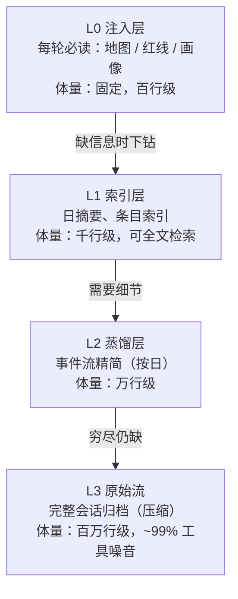
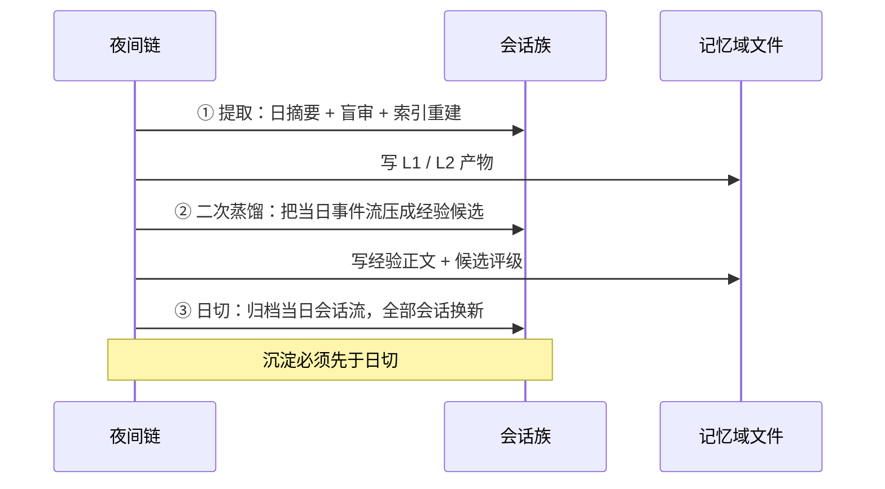

# 记忆卷：金字塔、夜晚沉淀与外部经验包

> 记忆域只做三件事：**给结构**（金字塔）、**给时机**（夜晚沉淀）、**给可信度**（外部经验包）。
> 它不负责"聪明"，只负责让"该知道的在预算内到达"，并让"该怀疑的有地方怀疑"。

---

## 1. 金字塔记忆：注入的是地图，不是内容

### 1.1 四层结构



| 层 | 内容 | 谁写 | 何时写 | 谁读 |
|---|---|---|---|---|
| L0 注入层 | 地图（文件用途与检索方式）、红线（跨会话禁令）、画像 | 人 / 主会话 | 会话开始、每轮动态注入 | 每个会话 |
| L1 索引层 | 每日摘要、经验条目索引 | 夜间链（自动） | 每晚 | 检索入口 |
| L2 蒸馏层 | 按日精简的事件流 | 夜间链（自动） | 每晚 | 需要原文细节时 |
| L3 原始流 | 完整会话流，压缩存放 | 宿主（自动） | 实时 | 最后兜底 |

**为什么是金字塔而不是"一个大知识库"**：因为检索的成本与噪音都随体量上升。金字塔的每一层是下一层的**降噪视图**（L0 是手册，L1 是摘要，L2 是精简，L3 是原始）。读者从小往上找，找到就停 —— 这既是成本纪律，也是**判断质量**纪律：拿 L3 的一个失败片段去下结论，比不查更糟。

这条是本域的第一条不变量：**注入的是地图，不是内容** [INV-M1] —— 读者拿到的是"去哪找"的指令，而不是被塞满的结论。

### 1.2 下钻纪律

```
① 先读 L0 地图 → 知道该去哪一层
② 用索引检索定位到"哪一天 / 哪一条"
③ 读该日的 L2 蒸馏（事件流精简）
④ 穷尽仍缺，才解压 L3
```

禁忌两条：

- **禁跳层**：不许一上来翻 L3。原始流里 ~99% 是工具调用与输出噪音，跳层等于用最脏的数据做判断 [INV-M2]。
- **禁全文读**：任何单一事实源（除 L0 那类固定体量文件）都不许整篇读入，只按章节/条目定位 [INV-M11]。体量一旦增长，"读全"就是上下文预算的慢性自杀。

### 1.3 单一事实源与派生产物

| 角色 | 例子 | 规则 |
|---|---|---|
| 单一事实源 | 经验正文、日蒸馏、红线文件 | 只由人去写或由夜间链追加，**不被索引反写** |
| 派生产物 | 全文检索索引、条目索引、摘要 | **只能整体重建**，禁止手改、禁止增量修补 [INV-M3] [INV-M5] |

派生产物要允许"随时删掉重建且不丢信息"，这是它区别于事实源的唯一判据。反之，任何不能重建的索引，实际上已经变成了第二事实源 —— 两份事实源必然不同步。

### 1.4 本层失效模式

| 失效 | 症状 | 判据 |
|---|---|---|
| 索引与正文漂移 | 检索命中内容与正文矛盾 | 随机抽 10 条命中，逐条回正文核对 |
| 归档未建索引 | 有文件，但检索永远查不到 | "文件数 vs 索引条目数"对不上 |
| 注入层膨胀 | 每轮开场固定成本吃掉预算 | 统计 L0 体量趋势，只增不减即膨胀 |
| 全文读回潮 | 单次会话上下文被一个文件吃光 | 记录单文件读取的最大体量 |

---

## 2. 夜晚沉淀：写入时机与顺序不可换

### 2.1 时序



三段之间**没有重试**，只有"缺一层报一层"。

### 2.2 三条硬顺序

| 顺序 | 为什么不可换 | 违反后果 | 不变量 |
|---|---|---|---|
| **沉淀先于清空** | 清空会真的删掉未落盘内容 | 当日细节永久消失，且不报错 | [INV-M4] |
| **索引整体重建，不做增量** | 条目删改后增量更新留下悬挂项 | 索引缓慢漂移，越用越不准 | [INV-M5] |
| **失败不重跑，缺一层报一层** | 重跑会把"缺口"变成"看起来补上了" | 链条断一环，日报却全绿 | [INV-M6] |

第 3 条最反直觉：**自动重试在这里是有害的**。夜间链的价值是产出，但它的第二价值是**报告缺口**。一次成功重跑掩盖的是一个"这次为什么断"的事实；无人值守系统里，事实比产出更贵。

### 2.3 监督者与被监督者的写入权必须分离

这是本卷最重要的一条，也是整套架构的根不变量之一：

> **判活行 / 审计行，不能由被监督的那个任务自己写。** [INV-X1]

原因不是信任问题，而是**逻辑问题**：一个任务写下"我跑完了"，只证明它执行到了写那一行的时候；它后面被杀掉，那一行依然存在且格式完美。更糟的是，如果它还负责写"我没跑"的那一行，那么它失败时，**唯一能报告它失败的机制也一起死了**。

正确结构：

| 角色 | 允许写 | 禁止写 |
|---|---|---|
| 被执行的任务 | 自己的业务产物 | 关于自己是否成功的结论 |
| 监督方（外部调度/检查脚本） | 关于任务的结论行 | 业务产物 |

**实践推论**：判活行应由"检查产物是否出现"的独立进程写，而不是由"产出该产物"的任务写。前者在后者失败时仍会运行。

### 2.4 本段失效模式

| 失效 | 症状 | 判据 |
|---|---|---|
| 观测点在中段 | 链条后半段死，面板仍绿 | 取链**末端**产物的时间戳做新鲜度判定 |
| 启动器吞退出码 | 调度器永远看到成功 | 执行体必须自报退出码 [INV-D3] |
| 沉淀与清空同批 | 偶发丢一天 | 检查时间戳顺序：产物 mtime < 会话归档时间 |
| 失败静默 | 只有"没有输出"，没有"失败" | 区分"空结果"与"未执行"两种状态 |

---

## 3. 外部经验包：记忆域内的第三子块，但不与记忆共享写权限

### 3.1 定位：读路径、物理载体、写权限是三件事

**记忆回答"在哪"，经验包回答"多可信"。** 说它们"同属记忆域"只在**一个维度**上成立，所以先拆维度，再谈归属：

| 维度 | 问的是什么 | 经验包的答案 |
|---|---|---|
| **读路径**（谁消费） | 谁会来拿它、是否走同一个检索入口 | **归记忆域**：与金字塔共用检索入口与注入预算 |
| **物理载体**（哪几份文件） | 是不是同一份文件 | **三份独立**：条目正文 / 置信度账本 / 盲审题库 |
| **写权限**（谁能改） | 谁能追加、谁能改分 | **不归记忆域**：执行侧只追加，外部盲审只改分，夜间链只重建派生索引 |

于是可以一句话说清：

> 经验包在**读**上属于记忆域 —— 读者不必知道手上这条是"记忆"还是"经验"，它与金字塔共用同一条检索路径。
> 经验包在**写**上不属于记忆域 —— 正文由执行侧追加，分数由外部盲审改动，夜间链对它只有"整体重建派生索引"一项权力。
> 也就是说：**记忆域持有它的读路径，不持有它的写权限；物理上它们从来不是同一份文件。**

为什么不用"归记忆域、只是写权限除外"这种句式：**"归属"是组织问题，写评分离是不变量。** 组织可以合并（本实现确实合并了），不变量不许让步 [INV-M9]。前一种句式会让读者理解成"原则上是一份、只是有个例外"，实际正相反。

反例判据（进自检清单）：**若某一步骤既能写正文又能改分数，则实现已违反 `INV-M9`。**

下面这张对照表说的是"读起来像不像一件事"与"写起来分不分两处"：

| | 记忆（金字塔） | 经验包 |
|---|---|---|
| 输入 | 会话与产物 | 生产会话片段 + 外部判定 |
| 输出 | 可检索的层级视图 | 带分数的条目 + 可引用证据 |
| 谁写 | 夜间链 | 执行侧（只写条目与证据） |
| 谁改分 | —— | **外部盲审（只改分数）** |
| 失效恐慌 | 查不到 | **信错** |

合并成一份文件的后果是可预测的：条目作者与评分者变成同一个，于是分数变成自我描述的镜像 [INV-M9]。

### 3.2 条目结构

```json
{
  "id": "EXP-0001",
  "title": "一句话结论（祈使句优先）",
  "type": "fact | pitfall | procedure | preference",
  "confidence": 0.0,
  "evidence": [
    {"kind": "session_snippet", "anchor": "<会话/轮次定位>", "strength": "measured | observed | claimed"}
  ],
  "tombstoned": false,
  "deprecated_by": null,
  "updated_at": "<ISO 时间>"
}
```

要点：

- `evidence` 必须指到**生产会话片段**，不接受"模型觉得自己对"或"文档里这么写" [INV-E4]。
- `strength` 与不变量表**同一套两维标注**：**运行状态**（全面运行 / 部分运行 / 仅约定 / 尚未实现）× **证据强度**（`Q0` 受控量化 / `Q1` 可追溯未量化 / `Q2` 观察未量化 / `Q3` 推理）[INV-M7]。
- **分数与证据分离**：一条条目可以既高分又只到 `Q1` —— 高分说的是「它在本机好用」，`Q1` 说的是「它的收益没被量化过」。读者必须能同时看到这两件事。
- `tombstoned` 而不是物理删除：被否定的经验仍是信息（"这条路试过，不行"）。

### 3.3 判定协议

| 动作 | 谁做 | 约束 |
|---|---|---|
| 写入条目 | 执行侧 | 必须带证据锚点，无锚点不许入库 |
| 打分/改分 | 外部盲审 | 区间 ±1/±2/±3；**负分必填理由**；输入清单**不带现有分数与作者自评** [INV-M8] |
| 直接否定 | 人 | 一票否决权，可越过任何分数 |
| 淘汰 | 夜间链 | 连续低分 → 墓碑，不删正文 |
| 豁免 | 配置 | 基础条目只拒负分、不拒正分（防止把地基条目评下去） |

**盲审员设计**（三条硬要求）：

1. **角色文本自包含**：盲审 prompt 不依赖会话上下文，单独拷出去也能跑。
2. **输入精准**：只给它该判的那几条 + 对应的原始片段，**不给**它上一次的分数。
3. **强制结构化输出**：分数 + 理由 + 锚点，缺一项即判为无效判定。

### 3.4 快慢分档

| 档 | 信号 | 生效时机 | 例子 |
|---|---|---|---|
| 快 | 越权、遗漏、明显违规 | **≤1 轮**纠偏 | 未确认就动敏感资源 → 立即拦并记 |
| 慢 | 条目可信度、判据阈值 | 周/月（夜间链入账） | 某条经验被三次证伪 → 降分至墓碑 |

混用这两种节奏是常见错误：用慢节奏处理越权 ⇒ 事故已经发生；用快节奏处理置信度 ⇒ 账本每秒抖动，最终没人再看分数 [INV-M10]。

### 3.5 本段失效模式

| 失效 | 症状 | 对策 |
|---|---|---|
| 自评膨胀 | 分数整体上移、无区分度 | 写评分离 + 盲审不带旧分 |
| 只增不减 | 错误经验越老越像权威 | 墓碑 + 可否定 |
| 样本偏差 | 只审被抽到的片段 | 抽样规则显式化，并记录未审比例 |
| 光环效应 | 高分条目一直高分 | 清单去标记（不给分数、不给作者） |

---

## 4. 最小契约（换实现也必须保留的东西）

### 4.1 文件清单（按角色，不按路径）

| 角色 | 形态 | 必需字段/结构 |
|---|---|---|
| 注入层 | 单文件，固定体量 | 文件用途 + 检索方式（**指令，不是内容**） |
| 索引层 | 可全文检索的索引 + 日摘要 | 日期、标题、来源、一句话摘要 |
| 蒸馏层 | 按日一份 | 事件、结论、缺口（缺哪一步） |
| 原始流 | 压缩归档 | 可解压、可按日期定位 |
| 经验正文 | 单文件，只追加 | 条目 ID、标题、类型、证据锚点 |
| 置信度账本 | 结构化记录 | 条目 ID、分数、理由、时间、判定者 |
| 题库/盲审索引 | 派生，可重建 | 条目 ID、待判问题、**无分数** |

### 4.2 三条可测判据（自检这套记忆是否还活着）

1. **可落地**：随便抽一条今日结论，能在 3 次检索内找到它的证据锚点。
2. **可重建**：删掉全部派生产物，夜间链能重建且检索结果不劣化。
3. **可否定**：随便挑一条经验，能演示"它被证伪后如何降分并墓碑化"的完整路径。

三条里任一条做不到，说明记忆域已经退化成"文件堆积"。

---

## 5. 本卷失效模式汇总（诚实清单）

- 沉淀失败但无人知 ⇒ 当天细节永远消失（顺序 + 静默双重原因）。
- 索引漂移 ⇒ 检索命中与正文矛盾，且无法判定哪边旧。
- 注入层膨胀 ⇒ 每轮固定成本上升，长期摊销失效。
- 自评膨胀 ⇒ 账本失去区分度，等于没有账本。
- 只增不减 ⇒ 错误经验固化，新人（新会话）被旧错误绑定。
- 全文读回潮 ⇒ 单文件吃光上下文，判断质量下降。

---

## 6. 从零搭一个最小可跑版本（顺序不能换）

1. 写一页**注入层**：文件地图（每份文件干什么、怎么检索）+ 十条以内的红线。
2. 建**索引层**：先上全文检索（中文必须处理分词/双字切分，别指望默认分词）。
3. 建**原始流归档**并接一个日切动作（先只要求"能清空且不丢文件"）。
4. 写**夜链第一步**：提取 → 摘要 → 索引重建，**并且**写一行"这一步成没成"的审计行（写入者是监督方）。
5. 再加**二次蒸馏**：把当日事件流压成经验候选（先不管评分）。
6. 最后加**外部盲审**：只在"候选 → 账本"这一处接入，先只做打分，不做预检。

到第 4 步就已经有一个能用的无人值守记忆；第 6 步才是可信度。**顺序反了会得到一堆没人信的结论。**
